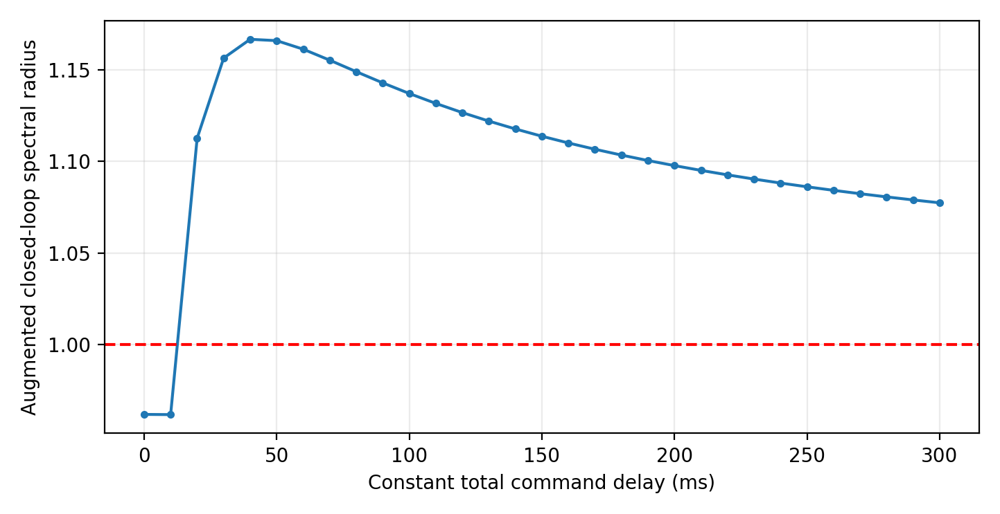
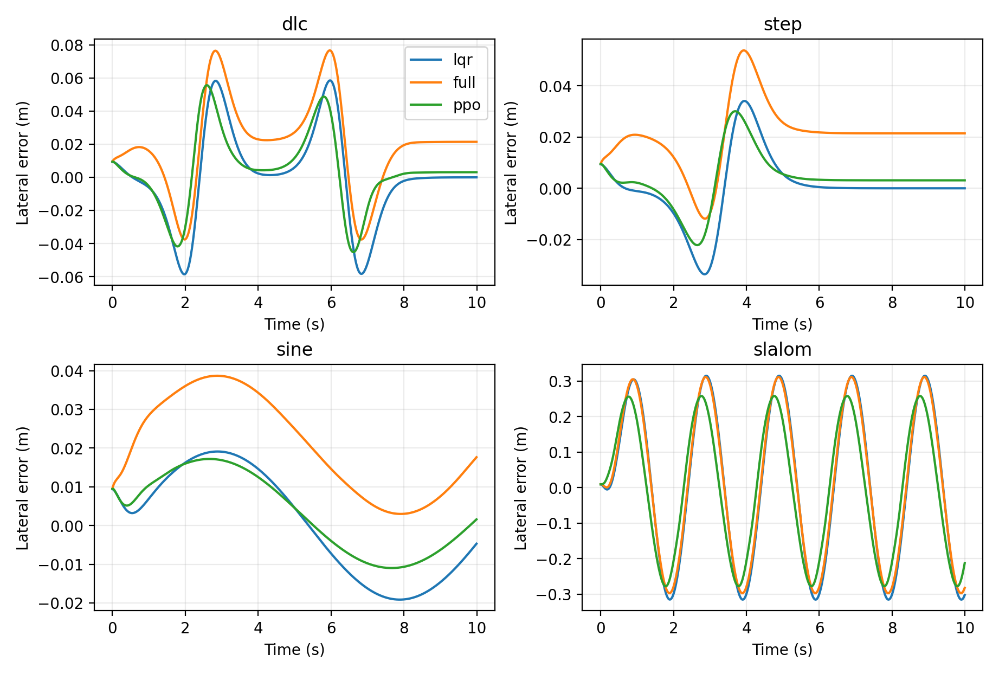
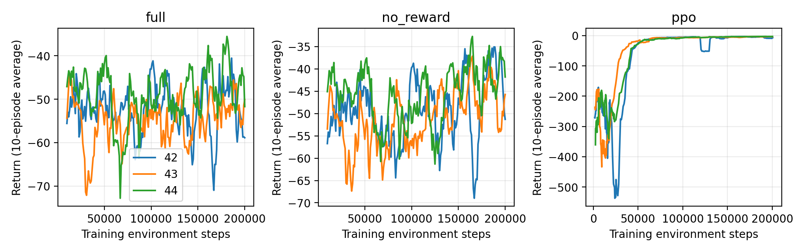

# LANS: Latency-Aware LQR–PPO Residual Path Tracking Using a Dynamic Bicycle Model

Rizwan Ali and Jie Tian

## Abstract

This paper reassesses a latency-aware hybrid controller comprising a linear quadratic regulator (LQR), a proximal policy optimization (PPO) steering residual, a prescribed latency-dependent gain, and steering saturation. The original dynamic bicycle model structure and vehicle parameter magnitudes are retained; tyre-stiffness signs are stated consistently and the LQR gain is designed for the actual 100 Hz sampled implementation. A new matched campaign trains three independent seeds for each of the full controller, latency-reward ablation, and PPO-only baseline. All nine policies receive 200,704 environment steps. The campaign includes 1,225 evaluation episodes with five common physical initialization seeds, held-out reference shapes, mass perturbations, actual command queues, and separately measured computation timing. On the no-delay double-lane-change reference, full LANS has mean penalized RMSE 0.0291 m, compared with 0.0286 m for LQR and 0.0176 m for PPO. These are new reconstruction results, not the previously reported measurements. A pure exogenous latency penalty does not make the fixed-size policy control its own inference time. The same dynamic model with the sampled LQR is locally Schur stable for constant command delays of 0 and 10 ms, but not for the tested delays of 20–300 ms. Thus gain attenuation does not establish arbitrary-delay stability. Matched timing, raw traces and failed cases are reported. No GPU energy ratio, certified worst-case execution time, or physical vehicle safety benefit is asserted.

Keywords: dynamic bicycle model; residual reinforcement learning; LQR; PPO; command delay; reproducibility.

## I. Introduction and contribution boundary

Path tracking under computation and transport delay requires separating the time needed to calculate a steering command from the time at which that command actually reaches the plant. A nominally stabilizing feedback controller may become unstable when its complete output is delayed. Adding a bounded learned residual or attenuating that residual cannot, by itself, remove this input delay.

PPO is an established policy-gradient method [1], and composing conventional feedback with a learned residual is established practice [2]. We therefore do not claim that combining LQR and PPO is a new control principle. The retained LANS framework is LQR feedback plus a bounded PPO steering correction, a prescribed latency-dependent weight, and final steering saturation. The term “neuro-symbolic” is removed because the analytical LQR branch does not implement symbolic reasoning, logical inference or a symbolic knowledge base. LANS is retained as the framework name.

The contribution is a transparent implementation and an empirical assessment of this particular latency-weighted residual controller on the retained dynamic bicycle model, including limitations and negative results. The study supplies (i) explicit causal delay and reward definitions; (ii) paired reward and deployment ablations with independent training seeds; (iii) matched timing and raw numerical evidence; and (iv) a conditional sampled-data stability statement together with fixed-delay counterexamples. These contributions do not establish superiority over the broader residual-control or delay-compensation literature. No predictor, observer, neural architecture expansion, changed vehicle plant, or replacement control framework is introduced to rescue a performance claim.

## II. Retained dynamic bicycle vehicle and sampled model

### A. Physical parameters and sign convention

The original parameter magnitudes are retained: mass $m=1650$ kg, yaw inertia $I_z=4224$ kg m$^2$, axle distances $l_f=1.2$ m and $l_r=1.4$ m, front and rear cornering-coefficient magnitudes $C_f=C_r=80000$ N/rad, speed $v_x=25$ m/s, and steering bound $|\delta|\le0.5$ rad. These are the supplied modelling assumptions; they are not newly identified or independently verified Tesla Model 3 specifications. The factor of two in the supplied tyre-force equations is retained. The supplied equations use signed coefficients: $k_f=-C_f$, $k_r=-C_r$. Interpreting the printed positive table magnitudes as positive signed coefficients instead produces antidamping; this inconsistency is corrected explicitly, rather than silently switching the simulation to a kinematic plant.

The same planar dynamic bicycle equations are used:

$$\dot v_y=-\frac{2(C_f+C_r)}{m v_x}v_y+\left(\frac{2(l_rC_r-l_fC_f)}{m v_x}-v_x\right)r+\frac{2C_f}{m}\delta,$$

$$\dot r=\frac{2(l_rC_r-l_fC_f)}{I_zv_x}v_y-\frac{2(l_f^2C_f+l_r^2C_r)}{I_zv_x}r+\frac{2l_fC_f}{I_z}\delta.$$

Here $r$ denotes yaw rate. With lateral and heading errors $e_y$ and $e_\psi$, the retained small-angle relations are $\dot e_y=v_y+v_xe_\psi$ and $\dot e_\psi=r-r_{ref}$. The error state is $x=[e_y,\dot e_y,e_\psi,\dot e_\psi]^T$. The nominal error matrix is

$$A=\begin{bmatrix}0&1&0&0\\0&-\frac{2(C_f+C_r)}{mv_x}&\frac{2(C_f+C_r)}m&\frac{2(l_rC_r-l_fC_f)}{mv_x}\\0&0&0&1\\0&\frac{2(l_rC_r-l_fC_f)}{I_zv_x}&\frac{2(l_fC_f-l_rC_r)}{I_z}&-\frac{2(l_f^2C_f+l_r^2C_r)}{I_zv_x}\end{bmatrix},\quad B=\begin{bmatrix}0\\2C_f/m\\0\\2l_fC_f/I_z\end{bmatrix}.$$

For a curved reference the exogenous inputs omitted in the original nominal derivation must be retained in simulation:

$$\dot x=Ax+B\delta+G r_{ref}+H\dot r_{ref},$$

$$G=[0,\ 2(l_rC_r-l_fC_f)/(mv_x)-v_x,\ 0,\ -2(l_f^2C_f+l_r^2C_r)/(I_zv_x)]^T,\quad H=[0,0,0,-1]^T.$$

For the small-angle reference $y_{ref}(t)$, $r_{ref}=\ddot y_{ref}/v_x$ and $\dot r_{ref}=\dddot y_{ref}/v_x$. These reference terms follow from the same vehicle equations and do not replace the plant. Exact zero-order-hold discretization of the augmented matrix $[A,B,G,H]$ at $h=0.01$ s yields $x_{k+1}=A_dx_k+B_d\delta_{applied,k}+G_dr_{ref,k}+H_d\dot r_{ref,k}$. The supplied code is the authoritative numerical specification.

### B. LQR implementation correction

The original Bryson limits give $Q=\operatorname{diag}(100,4,100,100)$ and $R=4$. LQR remains the analytical branch. Its gain is computed with the discrete algebraic Riccati equation for $(A_d,B_d,Q,R)$ [4], not by applying a continuous-time gain blindly at 100 Hz. The resulting gain is $K=[1.759064, 0.275525, 9.291091, 1.352412]$. The nominal gain is fixed in mass-perturbation and held-out tests.

This correction is material: the continuous-time CARE gain of the sign-consistent model has sampled closed-loop spectral radius 1.485995, exceeding one. The DARE gain gives 0.961827. Continuous-time stability alone therefore did not establish stability of the originally described 100 Hz implementation. The literal positive-signed printed model is also audited separately in `model_audit.json`; it is not used as a physically consistent replacement plant.

## III. Retained LANS controller, policy and actual delay execution

### A. Control composition and prescribed gain

The decision-stage command is

$$\delta_{cmd,k}=\operatorname{sat}_{0.5}\big(-Kx_k+\beta(\tau_k)\delta_{PPO,k}\big),$$

$$\beta(\tau)=\begin{cases}1,&\tau\le5\ \mathrm{ms},\\\exp[-0.8(\tau-5)],&\tau>5\ \mathrm{ms}.\end{cases}$$

where the numerical delay argument is in milliseconds. This retains the original gain threshold and decay constant. It is a prescribed scheduling rule, not a learned reduction in policy authority and not a derived optimizer. It is continuous but not differentiable at the threshold. Saturation enforces a steering-amplitude limit; it does not prove closed-loop stability.

### B. Complete PPO definition

The 11 inputs are the four current errors, longitudinal speed, four straight-heading preview lateral errors at 0.01, 0.02, 0.03 and 0.04 s, the previous observed delay, and the causal mean of the last ten observed delays. Numerical scaling is explicit in `dynamic_env.py`: lateral-error rate is divided by 5, heading error multiplied by 10, speed divided by 25, and delay features divided by 200 ms. Preview errors are computed from the current heading and reference samples. No future random delay, true perturbed plant parameter or simulator hidden state is inserted into the observation.

Both actor and critic use separate two-layer 64–64 ReLU networks. The actor mean has a linear scalar output. In the implementation used [3], the exploration distribution is Gaussian with a learned state-independent log standard deviation initialized to $-2$. It is not simultaneously an unbounded Gaussian action and a tanh-bounded Gaussian output. SB3 clips the sampled action to $[-1,1]$ before passing it to the environment, and the residual is $0.5$ times that action. Evaluation uses the clipped deterministic mean. Thus the applied residual is bounded, while the underlying exploration distribution is not.

Learning rate is $3\times10^{-4}$, rollout length 1024, minibatch size 64, update epochs 10, discount 0.99, GAE parameter 0.95, PPO clip range 0.2, entropy coefficient 0.01 and value-loss coefficient 0.5. No observation/reward normalizer or teacher policy is added. Nine fresh policies are trained: full reward, no latency reward, and PPO-only, each with training seeds 42, 43 and 44 and exactly 200,704 steps. All final checkpoints are reported. This matched reconstruction uses a fixed 25 m/s DLC training condition. It does not claim to reproduce undocumented historical million-step training, frozen-layer transfer learning, monotonically decreasing losses, or convergence to an optimal policy.

### C. Reward equations and what latency can influence

Let $u_k=\delta_{cmd,k}$ and let $\tau_k$ be the prescribed exogenous delay. The complete reward in this new campaign is

$$r_k=-e_{y,k+1}^2-4e_{\psi,k+1}^2-0.01u_k^2-0.1(u_k-u_{k-1})^2-\lambda_\tau\left[\tau_k/200+\max(0,(\tau_k-5)/200)^2\right].$$

The latency weight is $\lambda_\tau=0.02$ for full reward and zero for the reward ablation. Failure adds a penalty of 25. These explicitly specified reconstruction weights replace the incomplete historical reward description; they are not presented as recovered original weights.

For a fixed horizon and an exogenous delay schedule independent of steering actions, the sum of the pure latency terms is action-independent. It cannot make a fixed-size MLP choose a shorter inference path. With action-dependent episode termination, return differences can also contain horizon effects; finite-sample value fitting and optimization may change learned policies. None of these effects establishes control of computation time. A paired intervention check applies identical actions and random schedules with the term on and off: all 1,000 tested state transitions are identical and reward differences equal the specified term. Separate retraining, reported below, tests behavioural consequences without attributing gain attenuation to learning.

### D. Timestamped command queue and causality

Main results delay the complete fused steering command, including its LQR component. At tick $k$, the command receives a nonnegative integer delay $d_k=\lceil\tau_k/(1000h)\rceil$. Its FIFO release tick is $a_k=\max(k+d_k,a_{k-1})$. Commands are appended with generation and release timestamps. At each plant tick, all due commands are dequeued in order and the last released command is applied; otherwise the actuator holds its previous command, initialized to zero. Therefore no command executes before its assigned deadline, and variable delays cannot cause reordering. This is a simulated transport pipeline, not an emulation of a CPU whose entire control loop is physically blocked while inference runs.

The actor observes previous delay measurements. After the current decision, the scheduler knows the current injected transport delay and computes its prescribed gain before enqueueing. Measured host inference times and synthetic transport delays are distinct variables. A counterfactual residual-only delay experiment keeps local LQR current and queues only the residual; it is explicitly labelled as a delay-placement diagnostic and is not substituted for the main architecture to claim 200 ms stability.

## IV. Experimental protocol and reproducibility

The reference for training is $y(t)=1.75[\tanh((t-2)/0.6)-\tanh((t-6)/0.6)]$ m. It is a smooth double lane change; no ISO 3888-2 compliance is claimed without the prescribed course geometry and physical test conditions. Held-out shapes are a smooth step $1.75[1+\tanh((t-3)/0.8)]$, a sine $3\sin(2\pi0.1t)$, and a slalom $2\sin(2\pi0.5t)$. Policy weights and controller settings are not tuned on these held-out cases.

Each episode lasts at most 10 s (1,000 ticks). Initial errors are drawn from independent zero-mean Gaussians with standard deviations $[0.05,0.02,0.005,0.002]$. Evaluation seeds 3200–3204 are common across methods. Failure means $|e_y|>2.5$ m, $|e_\psi|>0.5$ rad, or nonfinite state; success means completing the finite episode without this termination. These are finite-horizon numerical criteria, not physical safety limits or a stability theorem.

The three main timing conditions are no transport delay; independently triggered delay with probability 0.1 and conditional uniform range 5–130 ms; and a constant 200 ms delay on every command. Exact schedules are paired across controllers. The queue adds real execution postponement in simulation. Mass tests use 1100 and 2200 kg with other parameters fixed, an isolated sensitivity analysis rather than a physically calibrated payload model.

Baselines use the same dynamic plant, sampling, reference, initial conditions, saturation and command channel. LQR uses the fixed DARE gain. PPO-only is retrained independently under the same step budget and network size, with no LQR branch. MPC uses the same $(A_d,B_d)$ and $Q,R$, a 20-step horizon and steering constraints $[-0.5,0.5]$. Its condensed quadratic program uses an analytical unconstrained solution when feasible and L-BFGS-B otherwise, with maximum 100 iterations, objective tolerance $10^{-10}$ and gradient tolerance $10^{-8}$. There is no delay predictor or actuator-rate constraint. Solver failures are counted; this is one declared MPC setting, not an optimized state-of-the-art baseline. The deployment ablations remove the gain or LQR branch from the same frozen full policy; these are distinct from the separately retrained reward and PPO-only comparisons.

All 1,225 episodes are retained: 1,080 learned-controller episodes and 145 deterministic-baseline episodes. Raw traces include generated and applied steering, delay, queue length, action generation timestamp and tracking error. No failed seed or failed episode is discarded. Observed RMSE is reported in the raw file; the principal tabulated metric penalizes early termination:

$$\mathrm{RMSE}_{pen}=\sqrt{\frac{\sum_{k=0}^n e_{y,k}^2+(1000-n)\max(2.5,|e_{y,n}|)^2}{1001}}.$$

For complete episodes it is ordinary RMSE including the initial state. A failed short trajectory is therefore not rewarded by averaging only its pre-failure observations. Completion counts accompany the principal comparisons. For learned methods, reported SD and two-sided 95% Student intervals use three training-seed means, each averaged over five paired physical initializations. For deterministic baselines the unit is the physical initialization, $n=5$. Three training seeds give limited statistical precision; intervals are exploratory and conditional on this test set. No claim of equivalence, comprehensive significance or policy optimality is made.

## V. Conditional stability analysis and counterexamples

Let $P\succ0$ be the DARE solution and $F=A_d-B_dK$. For the unsaturated, no-delay, zero-reference, zero-residual system,

$$F^TPF-P=-W,\qquad W=Q+K^TRK\succ0.$$

The numerical residual of this identity is 1.698e-10. Thus the correctly sampled nominal linear LQR is asymptotically stable. For $V=x^TPx$, the ellipsoid $V\le c$ with $c=0.5^2/(KP^{-1}K^T)=8.975285$ is invariant under this nominal zero-reference zero-residual controller and lies within the unsaturated steering region. This is a local nominal certificate, not a certificate for the complete delayed hybrid.

For the unsaturated no-delay system with additive bounded forcing $z_k$, $x_{k+1}=Fx_k+z_k$. Expanding $V$ and applying Young’s inequality gives

$$\Delta V\le-\frac{\lambda_{min}(W)}2\|x_k\|^2+\left(\|P\|+\frac{2\|F^TP\|^2}{\lambda_{min}(W)}\right)\|z_k\|^2.$$

Here $z_k$ includes the weighted PPO residual and reference forcing. This is an ISS-style bound for the stated unsaturated model: bounded forcing gives an ultimate bound, not zero tracking error. A nonzero constant residual generally gives a nonzero equilibrium $(I-F)^{-1}B_d\delta_{PPO}$. With saturation, the difference between the unsaturated and saturated steering must also be included, and an invariant region or another argument is needed. The preceding inequality is not a proof of global saturated stability.

For a fixed delay of $d$ samples on the complete command, the relevant system is $x_{k+1}=A_dx_k-B_dKx_{k-d}$ even when PPO is completely disabled. Its augmented matrix, not $F$ alone, determines linear stability. The computed spectral-radius scan is below one at 0 and 10 ms and above one at all tested values from 20 to 300 ms in 10 ms increments. This scan is not an exact continuous delay-margin computation and does not prove stability under arbitrary time-varying delay. It directly refutes the inference that suppressing PPO guarantees stability at 200 ms on the same delayed LQR channel. The previous 15 ms versus 50 ms claims are removed rather than reconciled by changing definitions after the fact.

## VI. New results and their interpretation

### A. Nominal tracking, residual influence and ablations

Table 1 reports matched no-delay DLC results. Full LANS is not presumed better than LQR or MPC. The frozen-policy zero-residual case is exactly the LQR baseline; therefore any degradation of the full policy relative to LQR measures interference from the residual under this condition. Full-policy no-gain and no-LQR deployment ablations are not described as independently retrained algorithms. Reward-off and PPO-only have their own three independent trained seeds.

| Controller | Penalized RMSE, m (mean ± SD) | 95% CI, m | Completed |
|---|---|---|---|
| lqr | 0.0286 ± 0.0022 | 0.0259 to 0.0314 | 5/5 |
| mpc | 0.0208 ± 0.0037 | 0.0161 to 0.0254 | 5/5 |
| full | 0.0291 ± 0.0049 | 0.0170 to 0.0413 | 15/15 |
| no_reward | 0.0263 ± 0.0015 | 0.0225 to 0.0300 | 15/15 |
| no_gain | 0.0291 ± 0.0049 | 0.0170 to 0.0413 | 15/15 |
| no_lqr | 2.3998 ± 0.0404 | 2.2996 to 2.5001 | 0/15 |
| ppo | 0.0176 ± 0.0057 | 0.0034 to 0.0319 | 15/15 |

Table 1. No-delay DLC results. “full” is LANS; “no_reward” is independently retrained without the latency term; “no_gain” and “no_lqr” are frozen-policy deployment interventions. Learned methods have three independent training units, not fifteen.

| Comparison (full minus other) | DLC/no-delay difference, m | Exploratory 95% CI, m |
|---|---|---|
| full_minus_no_reward | 0.002870 | -0.007984 to 0.013724 |
| full_minus_no_gain | 0.000000 | 0.000000 to 0.000000 |
| full_minus_no_lqr | -2.370709 | -2.460228 to -2.281190 |
| full_minus_ppo | 0.011496 | -0.001026 to 0.024017 |
| full_minus_lqr | 0.000493 | -0.011683 to 0.012669 |
| full_minus_mpc | 0.008380 | -0.003796 to 0.020556 |

Table 2. Paired differences in penalized RMSE; positive values mean full LANS is worse. Confidence intervals are exploratory with three training-seed differences. Small intervals around a finite-case comparison do not establish universal performance ordering.

The LQR cost and PPO reward are not identical objectives, and a finite-budget residual may add steering that moves an already accurate baseline away from the nominal solution. The raw traces and RMS residual columns expose this mechanism without claiming that PPO must improve an optimal nominal linear controller. A finite training budget, distribution shift and unmodelled nonlinear dynamics cannot be distinguished as universal causal explanations from these comparisons alone. No post hoc gain retuning or best-seed choice is used to conceal a worse nominal result.

### B. Actual delay execution and delay-placement limitation

| Controller | No delay, m | 10% mixed delay, m | Constant 200 ms, m | 200 ms completed |
|---|---|---|---|---|
| lqr | 0.0286 | 0.0380 | 2.3832 | 0/5 |
| mpc | 0.0208 | 0.0552 | 0.4621 | 5/5 |
| full | 0.0291 | 0.0711 | 2.3832 | 0/15 |
| no_reward | 0.0263 | 0.0848 | 2.3832 | 0/15 |
| no_gain | 0.0291 | 0.0588 | 2.3977 | 0/15 |
| no_lqr | 2.3998 | 2.3979 | 2.4181 | 0/15 |
| ppo | 0.0176 | 0.0192 | 2.3344 | 0/15 |

Table 3. Full-command delay results on DLC. Principal metrics include failures; no-delay and mixed-delay completion counts and every individual case are available in `summary.csv` and `episodes_all.csv`.

Delay attenuation acts on residual amplitude, while the queue acts on execution time. They are different mechanisms. Under a mixed FIFO delay schedule, head-of-line waiting and held steering can damage even a local nominally stable controller. Constant 200 ms full-command delay is a stress test, not evidence of a 200 ms stability guarantee. A residual-only delay diagnostic can leave LQR current, but its outcome depends on a different delay placement and cannot justify a claim about the main full-command channel. Complete diagnostic results are included with `scope=residual` rather than pooled with Table 3.

### C. Generalization and parameter sensitivity

| Controller | DLC, m | Smooth step, m | Sine, m | Slalom, m |
|---|---|---|---|---|
| lqr | 0.0286 | 0.0148 | 0.0153 | 0.2188 |
| mpc | 0.0208 | 0.0107 | 0.0072 | 0.1837 |
| full | 0.0291 | 0.0184 | 0.0184 | 0.2026 |
| ppo | 0.0176 | 0.0111 | 0.0111 | 0.1514 |

Table 4. No-delay reference-shape comparison. DLC is in distribution in shape; step, sine and slalom are held out. No aggregate claim of zero-shot generalization is made merely because a similar smooth step works. The linear small-angle model itself also limits interpretation of aggressive slalom commands; these are numerical stress tests, not evidence of tire-feasible high-speed driving.

| Controller | 1100 kg, m | 1650 kg, m | 2200 kg, m |
|---|---|---|---|
| lqr | 0.0161 | 0.0286 | 0.0431 |
| mpc | 0.0101 | 0.0208 | 0.0374 |
| full | 0.0194 | 0.0291 | 0.0412 |
| ppo | 0.0129 | 0.0176 | 0.0234 |

Table 5. Isolated mass sensitivity with all other parameters and controller gains fixed. Completion counts remain in the raw/summary tables. A small variation here does not establish robustness to simultaneously changed inertia, tyres, friction, payload location or nonlinear forces.

## VII. Matched computation timing, distance proxy and energy boundary

The new host is AMD EPYC 9V74 80-Core Processor, running Linux-6.18.57-x86_64-with-glibc2.41, Python 3.12.14, Torch 2.14.1+cpu and NumPy 2.3.5. This is not the original MacBook Air and not an automotive ECU. Training and episode campaigns finish before timing. Each method receives 100 warmup calls followed by 3,000 randomly interleaved timed calls on the same sequence of states, batch size one and one Torch/BLAS thread. The boundary includes observation assembly, deterministic decision and fusion/clipping; it excludes simulation, synthetic transport waiting, sensor acquisition, actuator motion and logging. LQR and deployment ablations use the same Python call path. Raw nanosecond samples are supplied.

| Controller | Mean, μs | P99, μs | Maximum observed, μs |
|---|---|---|---|
| lqr | 32.91 | 139.12 | 1491.00 |
| full | 204.05 | 512.86 | 1712.11 |
| no_reward | 211.30 | 560.70 | 4599.70 |
| no_gain | 206.03 | 569.94 | 2771.58 |
| no_lqr | 210.42 | 595.08 | 3540.16 |
| ppo | 205.64 | 527.54 | 3401.98 |
| mpc | 152.92 | 380.35 | 2211.18 |

Table 6. Matched computation times. P99 and the maximum observed sample are statistics of this run, not deterministic worst-case execution-time bounds.

The new full/PPO mean-time ratio is 0.992; a ratio above one means full LANS takes longer. The prior 49-fold speedup obtained by comparing measured inference time with a 100 Hz simulation period is withdrawn. Reward ablation does not change network dimensions or create a 49-fold inference-speed change. Reciprocity converts time to throughput only; the simulated control loop remains 100 Hz for every method. A controller that computes quickly does not automatically perform additional optimization iterations within a physical sensor cycle.

At 25 m/s, the computation-only travel proxy is $D_{comp}=25T_{decision}$. For full LANS the mean is 5.1013 mm and the P99 proxy is 12.8215 mm, using matched timing from this host. These values do not represent blindness, sensor age, end-to-end response, braking distance or a measured safety margin. Physical end-to-end latency requires measured sensing, communication, scheduling and actuator contributions. No assumed 100 Hz PPO period is substituted as an inference measurement.

No CPU-package power counter is available in this cloud machine. The original 350 W GPU comparison, 305-fold energy saving, 1/300 power claim and mass-production ECU suitability claims are removed. TDP is not measured workload power, and energy cannot be inferred fairly by combining different workloads, processors and active/idle assumptions. A future energy comparison would require matched hardware/workload accounting and measured counters or external instrumentation. It is not reported as completed here.

## VIII. Conclusion and limitations

The original LQR–PPO residual framework and dynamic bicycle model structure have been retained with openly documented sign and sampling corrections. New evidence replaces the historical timing, delay, reward and ablation claims. On this model, a learned residual may degrade the accurate nominal LQR response; its benefit is a measured question, not a premise. The prescribed latency gain controls residual authority, while a pure exogenous delay reward does not control a fixed MLP’s inference time. Delaying the entire fused command can destabilize the LQR fallback, and neither saturation nor a bounded residual proves global or arbitrary-delay stability.

The campaign reports every final seed, failure and measured timing sample. Its limits are a linear small-angle vehicle model, three training seeds per family, finite fixed training budget, synthetic delays, initial-condition rather than physical-process randomization, one declared MPC configuration, and one cloud host. No complete historical training reproduction, broad generalization, nonlinear safety proof, physical vehicle validation, certified WCET, automotive ECU readiness or measured energy saving is claimed. These restrictions are part of the results, not hidden prerequisites for their interpretation.

## Data and code availability

The accompanying revision package contains source, protocol, all nine final checkpoints, raw training logs, all episode records and traces, raw timing samples, model/stability checks and figure-generation code. It is supplied with this revision and is not claimed to have been published at a new GitHub URL. The earlier manuscript’s unverified public repository/completeness statement is removed. Original source archives remain unchanged.

## References

[1] J. Schulman, F. Wolski, P. Dhariwal, A. Radford, and O. Klimov, “Proximal Policy Optimization Algorithms,” arXiv:1707.06347, 2017. PPO reference and author metadata cross-checked against the OpenAI Spinning Up source documentation.

[2] T. Johannink et al., “Residual Reinforcement Learning for Robot Control,” arXiv:1812.03201, 2018. Title, authors and preprint identifier cross-checked against the authors’ project-page source.

[3] A. Raffin, A. Hill, A. Gleave, A. Kanervisto, M. Ernestus, and N. Dormann, “Stable-Baselines3: Reliable Reinforcement Learning Implementations,” Journal of Machine Learning Research, vol. 22, no. 268, pp. 1–8, 2021. Metadata cross-checked against the project’s official citation block.

[4] P. Virtanen et al., “SciPy 1.0: Fundamental Algorithms for Scientific Computing in Python,” Nature Methods, vol. 17, pp. 261–272, 2020, doi:10.1038/s41592-019-0686-2. Metadata cross-checked against SciPy’s official CITATION.bib.

