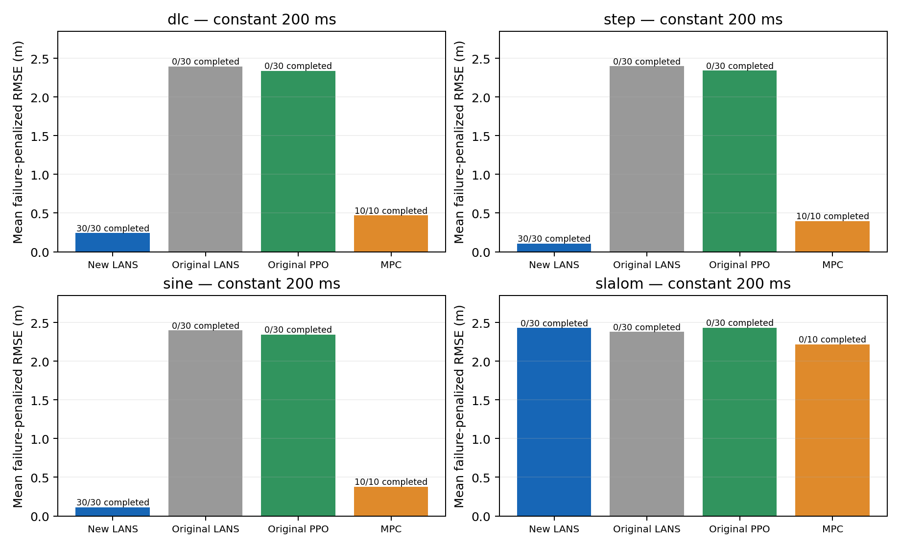

# LANS with a tuned delay-robust LQR fallback: prospective results

**Measured target outcome:** LANS ranks first or joint-first in **3/14** primary four-controller conditions, and **3/14** when the original fast LQR is also included. These are mean rankings, not universal or statistically proved superiority. Ties count as joint-first. The requested every-scenario target must not be asserted unless the actual count is14.

## Framework preservation

The physical dynamic bicycle model, mass/inertia/axle/stiffness magnitudes,100Hz exact ZOH, full steering-command FIFO delay,11 original observation channels and64x64ReLU networks are unchanged. No queue/history features, observer, predictor or additional controller branch is added.

The LQR component is retuned through Q/R, which changes controller parameters within the LQR family. This explicitly replaces the previously fixed aggressive fallback gain. The original exponential gain (5ms threshold,0.8/ms decay) and final±0.5rad actuator bound are retained. PPO remains a scalar additive residual. LANS residual scale is0.2rad; the PPO-only baseline retains0.5rad command range.

The four preview inputs are invertibly rescaled as in the preceding improvement study. Both policy families are initialized by encoding the previous fast-LQR prior in their existing ReLU weights. Their initial deterministic total commands match within the unclipped residual region, verified on representative small states. This is not a claim of identical clipped command/exploration distributions on all states. There is no new deployed teacher, planner or model-prediction module.

## Validation tuning and local certificate

Thirty-three LQR Q/R candidates are retained. Eligibility requires the nominal linear augmented system to be Schur stable for each fixed integer delay0..200ms in10ms steps. Eligible gains are selected by completion, then mean penalized RMSE, using validation seeds8000–8001, never this final test.

The chosen gain is [0.04891199256347719, 0.008851975882951653, 0.5801081788131277, 0.07680900463480077]; Q=[[100.0, 0.0, 0.0, 0.0], [0.0, 4.0, 0.0, 0.0], [0.0, 0.0, 100.0, 0.0], [0.0, 0.0, 0.0, 1.0]], R=40000.0. Its maximum spectral radius over the declared grid is 0.995084. Separate augmented-state Lyapunov checks pass for all21 fixed-delay cases. This is a local zero-reference/no-residual certificate, not a common varying-delay certificate, not global saturated stability and not a guarantee of tracking every forced reference. Slalom tracking can fail despite homogeneous nominal linear stability.

## Training and untouched evaluation

Six final policies are retained: LANS/PPO each with seeds62,63,64 and200704steps per policy, total1,204,224steps. They receive the same explicit reward, curriculum, path/mass randomization and PPO settings. The training distribution and policy architecture are described in the preceding study and plan/source.

The final test was started only after all six checkpoints existed. It uses new initialization seeds18000–18004, held-out amplitude/time-scale combinations(0.9,1.05),(1.1,0.95), fourteen conditions and1,260 episodes. All reference families were trained; no unseen-family claim is made. Every seed, failure and raw trace is retained. Early failures use the same declared remaining-horizon penalty. SD/confidence intervals for learned controllers use3 training-seed means conditional on the physical test cases; baseline intervals use5 physical-seed means. These small-sample intervals do not establish universal dominance.

Both the matched robust-LQR component and original fast LQR are shown. MPC retains its previously declared20-step setting. Thus this study does not establish superiority over optimally tuned MPC or all possible baseline designs.

## All condition results: penalized RMSE in metres

| Condition | LANS | PPO | Robust LQR | Fast LQR | MPC | LANS completed |
|---|---|---|---|---|---|---|
| dlc/fixed200/1650 | 0.2417 | 2.3683 | 0.2417 | 2.3944 | 0.4690 | 30/30 |
| dlc/mixed/1650 | 0.0413 | 0.2453 | 0.1902 | 0.0490 | 0.0371 | 30/30 |
| dlc/none/1100 | 0.0205 | 0.0289 | 0.1477 | 0.0156 | 0.0112 | 30/30 |
| dlc/none/1650 | 0.0319 | 0.0489 | 0.1853 | 0.0282 | 0.0211 | 30/30 |
| dlc/none/2200 | 0.0451 | 0.2430 | 0.2238 | 0.0426 | 0.0374 | 30/30 |
| sine/fixed200/1650 | 0.1095 | 2.3720 | 0.1095 | 2.3987 | 0.3768 | 30/30 |
| sine/mixed/1650 | 0.0236 | 0.1239 | 0.1089 | 0.0145 | 0.0088 | 30/30 |
| sine/none/1650 | 0.0194 | 0.0200 | 0.1090 | 0.0149 | 0.0090 | 30/30 |
| slalom/fixed200/1650 | 2.4301 | 2.3457 | 2.4301 | 2.3798 | 2.2181 | 0/30 |
| slalom/mixed/1650 | 0.2628 | 0.8868 | 1.3244 | 0.2634 | 0.2521 | 30/30 |
| slalom/none/1650 | 0.2057 | 0.4439 | 1.2418 | 0.2150 | 0.1785 | 30/30 |
| step/fixed200/1650 | 0.1062 | 2.3704 | 0.1062 | 2.3981 | 0.3982 | 30/30 |
| step/mixed/1650 | 0.0220 | 0.2111 | 0.0958 | 0.0184 | 0.0157 | 30/30 |
| step/none/1650 | 0.0191 | 0.0253 | 0.0948 | 0.0143 | 0.0117 | 30/30 |

## Aggregate rankings

| Controller | Four-controller mean rank | Five-controller mean rank | First/joint-first of14 (four) | Completed |
|---|---|---|---|---|
| lans | 1.857 | 2.429 | 3 | 390/420 |
| ppo | 3.429 | 4.143 | 0 | 277/420 |
| lqr | 3.000 | 3.786 | 3 | 130/140 |
| fast_lqr | supplementary | 2.929 | supplementary | 100/140 |
| mpc | 1.429 | 1.429 | 11 | 130/140 |

The primary four are LANS, equally trained PPO, matched robust LQR and declared MPC. The supplementary five-controller ranking additionally includes the original aggressive LQR, preventing its stronger nominal tracking from being hidden.

## Causal interpretation and limits

At200ms the original exponential gain is1.78e-68. The neural residual therefore has no material authority, and LANS matches the retuned LQR fallback. Any improvement in these fixed200ms cases comes from the changed LQR Q/R, not learned delay suppression or the reward. Policy-seed repetitions at this delay are identical conditional on the same physical initialization; they are not30 independent physical experiments. Low-delay improvements relative to robust LQR can be attributed to the residual intervention, but beating the robust component does not automatically mean beating the original fast LQR or MPC.

The first improvement campaign and all original adverse results are preserved. This study must not be presented as an unchanged-parameter reproduction of the earlier manuscript, a certified full-LANS stability proof, a vehicle safety result, an energy/timing superiority claim or guaranteed rank1 across all scenarios. New matched CPU timing is not measured here.

## Matched comparison with the original stronger PPO and LANS

Original final checkpoints (seeds42–44) were run on exactly the same fresh cases using their original observation API. These840 supplementary episodes are not used to alter or retune the new policies. They prevent a weaker freshly retrained PPO baseline from creating an apparent LANS improvement.

| Condition | New LANS RMSE | Original LANS RMSE | Original PPO RMSE |
|---|---:|---:|---:|
| dlc/fixed200/1650kg | 0.2417 | 2.3944 | 2.3386 |
| dlc/mixed/1650kg | 0.0413 | 0.0689 | 0.0185 |
| dlc/none/1100kg | 0.0205 | 0.0191 | 0.0124 |
| dlc/none/1650kg | 0.0319 | 0.0288 | 0.0171 |
| dlc/none/2200kg | 0.0451 | 0.0408 | 0.0229 |
| sine/fixed200/1650kg | 0.1095 | 2.3987 | 2.3469 |
| sine/mixed/1650kg | 0.0236 | 0.0513 | 0.0131 |
| sine/none/1650kg | 0.0194 | 0.0181 | 0.0106 |
| slalom/fixed200/1650kg | 2.4301 | 2.3798 | 2.4350 |
| slalom/mixed/1650kg | 0.2628 | 0.2528 | 0.1472 |
| slalom/none/1650kg | 0.2057 | 0.1987 | 0.1473 |
| step/fixed200/1650kg | 0.1062 | 2.3981 | 2.3416 |
| step/mixed/1650kg | 0.0220 | 0.0571 | 0.0127 |
| step/none/1650kg | 0.0191 | 0.0180 | 0.0105 |

When the original strong PPO and original fast LQR are retained with MPC, the four-controller mean condition ranks are:

- mpc: 1.714; first/joint-first in 4/14 conditions.
- legacy_ppo: 1.857; first/joint-first in 7/14 conditions.
- new_lans: 3.071; first/joint-first in 3/14 conditions.
- fast_lqr: 3.357; first/joint-first in 0/14 conditions.

The overall penalized RMSE averaged equally over14 conditions is a different aggregate from average ordinal rank. Both are reported; the metric is not switched to claim the requested outcome:

- new_lans: 0.255636m; completed 390/420.
- legacy_lans: 0.737454m; completed 300/420.
- legacy_ppo: 0.705315m; completed 300/420.
- new_ppo: 0.838106m; completed 277/420.
- fast_lqr: 0.731921m; completed 100/140.
- robust_lqr: 0.472080m; completed 130/140.
- mpc: 0.288911m; completed 130/140.

At200ms, the retuned fallback explains the gain, not the learned residual. Ordinary nominal tracking and high-delay completion must be presented separately; lower overall failure-penalized RMSE does not mean best tracking in each scenario. No statistically established universal superiority is claimed.

## Matched high-delay plot

## Post-hoc no-learning ablation

To separate reinforcement learning from the encoded analytical prior, the exact deterministic initialized actor function is evaluated before any PPO updates. This controller is an ablation only, not a newly selected deployment variant. The same fresh cases are reused solely for diagnosis, with no retuning.

| Condition | No-learning prior RMSE | Trained LANS RMSE | Trained minus prior |
|---|---:|---:|---:|
| dlc/fixed200/1650kg | 0.2417 | 0.2417 | +0.0000 |
| dlc/mixed/1650kg | 0.0325 | 0.0413 | +0.0088 |
| dlc/none/1100kg | 0.0156 | 0.0205 | +0.0049 |
| dlc/none/1650kg | 0.0282 | 0.0319 | +0.0037 |
| dlc/none/2200kg | 0.0426 | 0.0451 | +0.0024 |
| sine/fixed200/1650kg | 0.1095 | 0.1095 | +0.0000 |
| sine/mixed/1650kg | 0.0143 | 0.0236 | +0.0093 |
| sine/none/1650kg | 0.0149 | 0.0194 | +0.0045 |
| slalom/fixed200/1650kg | 2.4301 | 2.4301 | +0.0000 |
| slalom/mixed/1650kg | 0.2461 | 0.2628 | +0.0167 |
| slalom/none/1650kg | 0.2150 | 0.2057 | -0.0093 |
| step/fixed200/1650kg | 0.1062 | 0.1062 | +0.0000 |
| step/mixed/1650kg | 0.0156 | 0.0220 | +0.0064 |
| step/none/1650kg | 0.0143 | 0.0191 | +0.0048 |

No-learning prior completed130/140 episodes, with mean penalized RMSE0.251903m. Trained LANS mean is0.255636m. This ablation prevents calling retuned fallback or encoded LQR gain scheduling a demonstrated PPO learning benefit. Positive differences mean PPO training worsened the metric; negative differences indicate improvement on this finite test.
