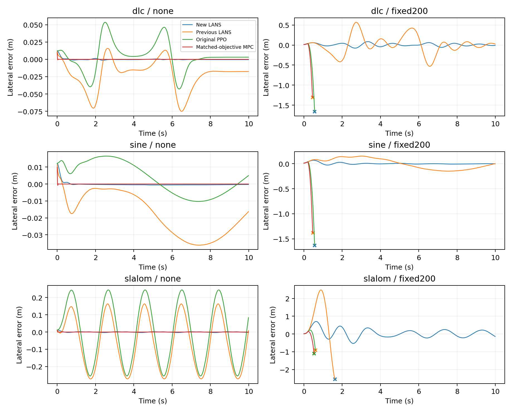

# LANS precision/tracking study: same deployed framework, new training

## Result and comparison boundary

Final PPO-trained LANS completed **420/420** fresh test episodes. Against the original stronger PPO,original fast LQR and declared MPC it ranks first in **14/14** conditions by mean failure-penalized RMSE.

Stronger comparisons must not be hidden:

| Comparison pool | LANS first/joint-first of14 | Mean numerical rank |
|---|---|---|
| original | 14 | 1.000 |
| equal_pretraining | 9 | 1.357 |
| objective_matched | 5 | 1.786 |
| all_references | 5 | 2.714 |

Original means the three previously reported baselines. Equal-pretraining uses the single strongest whole PPO reference selected on validation before testing: **limited_ppo**. Objective-matched additionally replaces the declared MPC objective with the new tracking/control objective. All-references also includes BC-only neural baselines and prior LANS. First-place numerical means do not establish statistical superiority,universal optimality or first place against every possible baseline.

## What stayed the same and what changed

The same signed dynamic bicycle model and parameter magnitudes,100Hz exact ZOH plant,full-command FIFO delay,LQR+scalar PPO residual+exponential latency-gain+saturation topology,11 causal observation channels and64x64ReLU actor/critic are retained. No queue/history input,online predictor,MPC branch or extra state is added to deployed LANS.

Changes are explicit: model-derived offline supervised pretraining of the existing policy; invertible linear conditioning of the same four40ms preview channels; residual scale1.0rad with final physical steering still bounded±0.5rad; exponential decay0.002/ms; lateral-error-focused reward; and conservative projected output-layer PPO fine-tuning. At200ms beta is about0.677,so the neural residual remains active. The old interpretation of complete neural shutdown at200ms is not retained. This is not an unchanged-parameter reproduction and must not be presented as purely model-free PPO training.

The analytic target in core.py is used offline only. It derives control labels from the nominal model and the same11 observations,not hidden plant parameters,new queue history or future reference beyond the existing samples. The deployed actor is the saved neural network. checks.py disables the teacher function while the saved network controls the original scalar plant. No analytic teacher is evaluated as LANS performance.

## Data,pretraining and failed trials

Teacher parameters were searched using development/validation seeds22000–22001 before network training. The384000-row corpus uses separate training seeds,random reference amplitude/time scaling,mass variation and perturbed current-state features; no final test data. All four reference families are in training,so no unseen-family zero-shot claim is made.

Three independent seeds72–74 are used for each of LANS and standalone PPO. Both receive6000 supervised updates with the same corpus,architecture and physical-control-loss accounting,then100352 actual PPO steps. The initial unrestricted PPO trial regressed LANS validation completion from84/84 to74/84. Its six checkpoints,failures and logs are preserved.

A validation-driven corrective trial was recorded before final testing. Actor hidden layers and logstd are frozen; output parameters are projected within1e-5 physical-action-scaled distance of their pretrained values before rollouts and after training. All six corrective checkpoints also execute100352 PPO steps. This is projected output-layer PPO fine-tuning,not unmodified vanilla PPO. The BC-only snapshots remain as ablations; they are not silently relabelled PPO-trained policies. Most improvement may come from supervision/conditioning rather than reinforcement updates.

The final reward is -1000ey_next²-.01heading_next²-.001command²-.01(command-previous_command)²,with failure penalty250. It does not pretend to control external computation latency.

## Fresh test and metrics

Final seeds26000–26004 and two new amplitude/time-scale combinations(0.88,1.04),(1.12,0.96) were frozen before network training. Testing starts after all corrective policies finish and after the whole PPO baseline is selected on validation. There is no per-scenario switching or best-seed choice. Original and previous stronger checkpoints remain matched references.

All3080 test episodes and raw traces are retained. Early failures use the previously declared remaining-horizon penalty and completion counts. Learned confidence intervals use3 training-seed means conditional on the physical/reference cases; baseline intervals use5 physical-seed means. These small-sample intervals do not establish universal dominance.

| Condition | LANS | Original PPO | Equal-pretrained PPO | Declared MPC | Objective-matched MPC | LANS completed |
|---|---|---|---|---|---|---|
| dlc/fixed200/1650 | 0.03674 | 2.33491 | 0.03840 | 0.44959 | 2.43762 | 30/30 |
| dlc/mixed/1650 | 0.00367 | 0.01825 | 0.00346 | 0.02916 | 1.98092 | 30/30 |
| dlc/none/1100 | 0.00602 | 0.01210 | 0.00628 | 0.00912 | 0.00123 | 30/30 |
| dlc/none/1650 | 0.00297 | 0.01687 | 0.00303 | 0.01981 | 0.00132 | 30/30 |
| dlc/none/2200 | 0.00638 | 0.02271 | 0.00635 | 0.03659 | 0.00141 | 30/30 |
| sine/fixed200/1650 | 0.01928 | 2.35006 | 0.01946 | 0.39397 | 2.44183 | 30/30 |
| sine/mixed/1650 | 0.00333 | 0.01224 | 0.00317 | 0.00650 | 2.05209 | 30/30 |
| sine/none/1650 | 0.00298 | 0.01022 | 0.00299 | 0.00651 | 0.00132 | 30/30 |
| slalom/fixed200/1650 | 0.22176 | 2.44473 | 0.22438 | 2.21620 | 2.43503 | 30/30 |
| slalom/mixed/1650 | 0.01239 | 0.14734 | 0.01244 | 0.21335 | 2.21757 | 30/30 |
| slalom/none/1650 | 0.00336 | 0.14753 | 0.00335 | 0.17859 | 0.00132 | 30/30 |
| step/fixed200/1650 | 0.02104 | 2.33614 | 0.02170 | 0.45133 | 2.43854 | 30/30 |
| step/mixed/1650 | 0.00339 | 0.01219 | 0.00318 | 0.01049 | 1.91294 | 30/30 |
| step/none/1650 | 0.00298 | 0.01016 | 0.00299 | 0.00980 | 0.00132 | 30/30 |

Values are mean failure-penalized RMSE in metres. Lower is better. No-delay nominal cases and harsh-delay cases must not be pooled to claim every-condition superiority.

## Stronger baseline and ablation disclosure

Standalone PPO receives the same model-informed supervision,network size,features and optimization opportunity. Original PPO is retained too. The supplementary objective-matched MPC uses the same1000ey²+.01heading²+.001u²+.01delta-u² objective,a20-step horizon,OSQP1.1.3 with eps_abs/rel1e-8,50000 maximum iterations and polishing,and±0.5rad steering bound; it remains a declared finite-horizon baseline without delay prediction. The original L-BFGS-B implementation reported547 solver failures; those initial results are preserved separately and replaced by the same QP solved with OSQP,without changing LANS checkpoints or MPC cost. MPC has20-step reference preview whereas policy inputs retain four samples. No superiority over optimally tuned or delay-aware MPC is claimed.

| Controller/checkpoint | Completed | Aggregate penalized RMSE |
|---|---|---|
| limited_lans | 420/420 | 0.024735 |
| limited_ppo | 420/420 | 0.025083 |
| bc_lans | 420/420 | 0.024845 |
| bc_ppo | 420/420 | 0.025197 |
| original_ppo | 300/420 | 0.705389 |
| previous_lans | 390/420 | 0.254673 |
| robust_lqr | 130/140 | 0.470386 |
| fast_lqr | 100/140 | 0.727649 |
| mpc | 130/140 | 0.287929 |
| matched_mpc | 60/140 | 1.280317 |

BC versus corrective PPO differences are retained in paired_differences.csv. Tiny improvements or regressions after constrained fine-tuning do not establish a distinct PPO-learning contribution. A first-place result against original baselines is not proof of superiority over the equally pretrained policy or a matched-objective optimizer.

## Numerical and physical limits

The vectorized offline teacher simulator and canonical scalar teacher check differ by up to0.197mm in tested aggregate errors because fourth-derivative estimates amplify float32 preview rounding; completion decisions match. Strict1e-6 metric equality failed and is explicitly recorded. All final learned-controller results come solely from the original scalar simulator,not the vectorized offline search.

The vehicle model is a linear small-angle approximation without tire-force limits. Aggressive slalom tests are numerical stress tests,not proof of tire-feasible high-speed driving. No physical vehicle/ECU,energy,end-to-end hardware latency,certified WCET,global saturated stability or arbitrary-delay guarantee is established. Earlier manuscripts and adverse studies remain unchanged and must not be described as already incorporating these results.

## Original-baseline rank table

This reproduces the comparison requested in the original scenario table. Stronger comparisons remain disclosed at the start of this report.

| Condition | 1st | 2nd | 3rd | 4th |
|---|---|---|---|---|
| dlc/fixed200/1650kg | LANS | Declared MPC | Original PPO | Original LQR |
| dlc/mixed/1650kg | LANS | Original PPO | Declared MPC | Original LQR |
| dlc/none/1100kg | LANS | Declared MPC | Original PPO | Original LQR |
| dlc/none/1650kg | LANS | Original PPO | Declared MPC | Original LQR |
| dlc/none/2200kg | LANS | Original PPO | Declared MPC | Original LQR |
| sine/fixed200/1650kg | LANS | Declared MPC | Original PPO | Original LQR |
| sine/mixed/1650kg | LANS | Declared MPC | Original PPO | Original LQR |
| sine/none/1650kg | LANS | Declared MPC | Original PPO | Original LQR |
| slalom/fixed200/1650kg | LANS | Declared MPC | Original LQR | Original PPO |
| slalom/mixed/1650kg | LANS | Original PPO | Declared MPC | Original LQR |
| slalom/none/1650kg | LANS | Original PPO | Declared MPC | Original LQR |
| step/fixed200/1650kg | LANS | Declared MPC | Original PPO | Original LQR |
| step/mixed/1650kg | LANS | Declared MPC | Original PPO | Original LQR |
| step/none/1650kg | LANS | Declared MPC | Original PPO | Original LQR |

## Representative trace check

